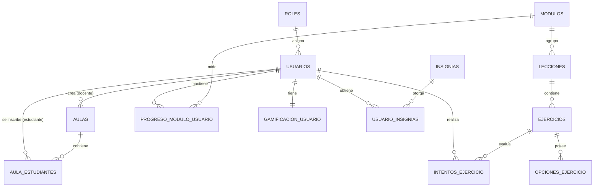

# Modelo de Base de Datos Relacional — Tutor Inteligente SABD

Este documento define, justifica y explica la arquitectura de base de datos del proyecto para garantizar **integridad referencial, normalización (3FN), rendimiento en consultas analíticas** y una **defensa técnica sólida** frente al profesor de la cátedra.

---

## 1. Elección del SGBD y Justificación Técnica

### Motor Seleccionado: **PostgreSQL (Relacional)**

¿Por qué elegimos una base de datos relacional (**PostgreSQL**) y no una NoSQL (como Firebase Firestore o MongoDB)?

1. **Naturaleza altamente relacional del dominio:** Los usuarios pertenecen a aulas, los módulos contienen lecciones, las lecciones contienen ejercicios con opciones y cada intento conecta un estudiante con un ejercicio específico. En un modelo relacional, estas relaciones se protegen a nivel de motor mediante Claves Foráneas (`FOREIGN KEY`).
2. **Garantía ACID:** Al finalizar un ejercicio, el sistema registra el intento, recalcula el dominio adaptativo y suma XP. Las transacciones ACID aseguran que nunca quede un puntaje sumado sin su intento registrado (atomicidad y consistencia).
3. **Potencia para el Módulo 4 (Analítica Docente):** Responder *"¿cuál es el tema con mayor tasa de error en el aula 08S-2630-D2?"* requiere agregaciones (`COUNT`, `AVG`, `GROUP BY`, `JOIN`) que SQL resuelve de forma nativa, rápida y precisa, a diferencia de bases documentales donde estas consultas son costosas o requieren duplicar datos.
4. **Coherencia directa con el Capítulo I y la materia:** El *Alcance del Proyecto* establece explícitamente el uso de *"una base de datos relacional para garantizar la integridad, almacenamiento y consulta rápida del historial de los estudiantes"*.
5. **Integración con Flutter/Dart:** A través de **Supabase** (que usa PostgreSQL real por debajo) o una API REST, Flutter consume los datos de forma segura sin exponer credenciales de la base de datos en el dispositivo móvil.

---

## 2. Diagrama Entidad-Relación (Modelo Conceptual)



### Resumen de Cardinalidades Clave
* **`ROLES` (1) a `USUARIOS` (N):** Un rol (`ESTUDIANTE`, `DOCENTE`) pertenece a muchos usuarios; cada usuario tiene un rol principal.
* **`AULAS` (N) a `USUARIOS` (M):** Un docente dicta muchas aulas (`1:N`), y muchos estudiantes pueden estar inscritos en distintas aulas/materias (`N:M`), resuelta mediante la tabla asociativa `AULA_ESTUDIANTES`.
* **`MODULOS` (1) $\rightarrow$ `LECCIONES` (N) $\rightarrow$ `EJERCICIOS` (N) $\rightarrow$ `OPCIONES_EJERCICIO` (N):** Jerarquía pedagógica limpia tipo Duolingo.
* **`USUARIOS` (1) a `INTENTOS_EJERCICIO` (N):** Tabla transaccional histórica (cada respuesta del alumno es una fila inmutable para auditoría e IA).
* **`USUARIOS` (N) a `MODULOS` (M):** Resuelta por `PROGRESO_MODULO_USUARIO`, que guarda el estado adaptativo actual del estudiante en cada módulo.

---

## 3. Explicación Sencilla de Cada Tabla (Diccionario Funcional)

El modelo consta de **12 tablas** organizadas en los 4 módulos del sistema:

### A. Módulo de Usuarios y Aulas
1. **`roles`**: Catálogo de perfiles (`ESTUDIANTE`, `DOCENTE`, `ADMIN`). Evita textos libres mal escritos.
2. **`usuarios`**: Datos básicos de acceso (`id`, `nombre_completo`, `correo`, `password_hash`, `rol_id`, `activo`, `creado_en`).
3. **`aulas`**: Representa cada salón/sección (ej. `nombre = 'SABD Sección D2'`, `codigo_acceso = 'SABD-D2'`, `docente_id`). Permite que el sistema maneje múltiples aulas numerosas o multigrado simultáneamente.
4. **`aula_estudiantes`**: Tabla puente entre estudiantes y aulas (`aula_id`, `estudiante_id`, `fecha_inscripcion`).

### B. Módulo de Micro-Aprendizaje (Estructura tipo Duolingo)
5. **`modulos`**: Grandes temas de la materia (ej. *Modelo E-R*, *Normalización*, *SQL Básico*) con un campo `orden` para el mapa visual.
6. **`lecciones`**: Micro-unidades dentro de cada módulo (ej. *1FN: Atomicidad*, *Claves Foráneas*) con `orden` y `xp_recompensa`.
7. **`ejercicios`**: Banco de preguntas. Incluye:
   * `tipo_ejercicio`: `MULTIPLE_CHOICE`, `TRUE_FALSE`, `FILL_SQL`, `ORDER_QUERY`.
   * `nivel_dificultad`: Entero del `1` al `5` (clave para el motor adaptativo).
   * `tiempo_estimado_seg`: Referencia para saber si el estudiante respondió con fluidez.
   * `explicacion_pedagogica`: Texto de retroalimentación inmediata al responder.
8. **`opciones_ejercicio`**: Almacena cada opción posible de un ejercicio (`texto_opcion`, `es_correcta`, `orden_correcto`). Separarla garantiza la Primera Forma Normal (1FN).

### C. Módulo de Algoritmo Adaptativo (IA) y Trazabilidad
9. **`intentos_ejercicio`** *(Tabla más importante para la defensa)*: Registra **cada vez** que un estudiante responde un ejercicio:
   * `es_correcto` (booleano)
   * `tiempo_respuesta_ms` (milisegundos exactos medidos por Flutter)
   * `dificultad_al_momento` (dificultad que tenía el ejercicio cuando se respondió)
   * `fecha_intento`
   * *¿Por qué existe esta tabla aparte del progreso?* Porque guarda la **historia completa**. Sin ella no podríamos saber qué ejercicios falla toda la clase, cuánto tardan o cómo evolucionó un alumno a lo largo del semestre.
10. **`progreso_modulo_usuario`**: Almacena la "foto actual" del motor adaptativo para un estudiante en un módulo específico:
    * `nivel_dominio` ($0.00$ a $100.00$)
    * `dificultad_actual` ($1$ a $5$)
    * `racha_errores_consecutivos` (para activar la ruta de refuerzo automáticamente)
    * `estado` (`BLOQUEADO`, `EN_PROGRESO`, `DOMINADO`)

### D. Módulo de Gamificación
11. **`gamificacion_usuario`**: Relación `1:1` con `usuarios` (solo estudiantes). Guarda `xp_total`, `nivel_actual`, `racha_dias_actual`, `mejor_racha_dias` y `ultima_fecha_practica`.
12. **`insignias` y `usuario_insignias`**: Catálogo de medallas (ej. *"Maestro de la 3FN"*, *"Racha de 7 días"*) y registro de qué estudiante desbloqueó cuál insignia y cuándo.

---

## 4. Normalización Paso a Paso (Cómo Defenderla)

Esta es casi con seguridad una pregunta directa en una materia de Bases de Datos. Así se demuestra que el modelo está en **Tercera Forma Normal (3FN)**:

* **Primera Forma Normal (1FN — Atomicidad):**
  * No existen grupos repetitivos ni columnas multivaluadas.
  * *Ejemplo defendible:* En lugar de guardar las opciones de una pregunta como un texto `"A, B, C, D"` dentro de `ejercicios`, se creó la tabla `opciones_ejercicio` donde cada fila es un valor atómico.
* **Segunda Forma Normal (2FN — Sin Dependencias Parciales):**
  * Todas las tablas tienen clave primaria simple (`BIGINT GENERATED ALWAYS AS IDENTITY`) o clave compuesta pura (como `aula_estudiantes` y `usuario_insignias`), donde todos los atributos no clave dependen de la **totalidad** de la clave primaria.
  * *Ejemplo defendible:* En `progreso_modulo_usuario`, el `nivel_dominio` depende tanto de `usuario_id` como de `modulo_id` juntos, no de uno solo.
* **Tercera Forma Normal (3FN — Sin Dependencias Transitivas):**
  * Ningún atributo no clave depende de otro atributo no clave.
  * *Ejemplo defendible:* El nombre del docente no se repite en `aula_estudiantes` ni en `intentos_ejercicio`; solo vive en `usuarios` y se enlaza por `docente_id` en `aulas`. Igualmente, los nombres de roles viven en `roles` y las descripciones de insignias en `insignias`.
  * **Nota de diseño sobre `gamificacion_usuario`:** Separar XP y rachas de `usuarios` evita llenar de valores `NULL` las filas de los usuarios con rol `DOCENTE` y reduce bloqueos de escritura cuando los estudiantes actualizan su puntaje constantemente.

---

## 5. Script SQL Completo (PostgreSQL DDL)

Este script está listo para ejecutarse en PostgreSQL / Supabase e incluye restricciones de integridad (`CHECK`, `UNIQUE`, `FK`) e índices de rendimiento.

```sql
-- ============================================================================
-- PROYECTO: Tutor Inteligente de Micro-Aprendizaje Adaptativo (Enfoque SABD)
-- SGBD: PostgreSQL 15+
-- ============================================================================

-- 1. ROLES
CREATE TABLE roles (
    id SMALLINT GENERATED ALWAYS AS IDENTITY PRIMARY KEY,
    nombre VARCHAR(30) NOT NULL UNIQUE CHECK (nombre IN ('ESTUDIANTE', 'DOCENTE', 'ADMIN'))
);

-- 2. USUARIOS
CREATE TABLE usuarios (
    id BIGINT GENERATED ALWAYS AS IDENTITY PRIMARY KEY,
    rol_id SMALLINT NOT NULL REFERENCES roles(id) ON UPDATE CASCADE ON DELETE RESTRICT,
    nombre_completo VARCHAR(120) NOT NULL,
    correo VARCHAR(150) NOT NULL UNIQUE,
    password_hash TEXT NOT NULL,
    activo BOOLEAN NOT NULL DEFAULT TRUE,
    creado_en TIMESTAMPTZ NOT NULL DEFAULT NOW()
);

-- 3. AULAS (Soporte para aulas numerosas y multigrado)
CREATE TABLE aulas (
    id BIGINT GENERATED ALWAYS AS IDENTITY PRIMARY KEY,
    docente_id BIGINT NOT NULL REFERENCES usuarios(id) ON DELETE RESTRICT,
    nombre VARCHAR(120) NOT NULL,
    codigo_acceso VARCHAR(20) NOT NULL UNIQUE,
    periodo_academico VARCHAR(30) NOT NULL, -- Ej: '2026-II'
    activa BOOLEAN NOT NULL DEFAULT TRUE,
    creado_en TIMESTAMPTZ NOT NULL DEFAULT NOW()
);

-- 4. INSCRIPCIONES DE ESTUDIANTES EN AULAS (Relación N:M)
CREATE TABLE aula_estudiantes (
    aula_id BIGINT NOT NULL REFERENCES aulas(id) ON DELETE CASCADE,
    estudiante_id BIGINT NOT NULL REFERENCES usuarios(id) ON DELETE CASCADE,
    fecha_inscripcion TIMESTAMPTZ NOT NULL DEFAULT NOW(),
    PRIMARY KEY (aula_id, estudiante_id)
);

-- 5. MÓDULOS TEMÁTICOS (Ruta tipo Duolingo)
CREATE TABLE modulos (
    id BIGINT GENERATED ALWAYS AS IDENTITY PRIMARY KEY,
    titulo VARCHAR(100) NOT NULL,
    descripcion TEXT NOT NULL,
    orden SMALLINT NOT NULL UNIQUE CHECK (orden > 0),
    icono VARCHAR(50),
    activo BOOLEAN NOT NULL DEFAULT TRUE
);

-- 6. LECCIONES (Micro-unidades dentro de cada módulo)
CREATE TABLE lecciones (
    id BIGINT GENERATED ALWAYS AS IDENTITY PRIMARY KEY,
    modulo_id BIGINT NOT NULL REFERENCES modulos(id) ON DELETE CASCADE,
    titulo VARCHAR(120) NOT NULL,
    resumen_teorico TEXT, -- Micro-cápsula previa al ejercicio o de refuerzo
    orden SMALLINT NOT NULL CHECK (orden > 0),
    xp_recompensa INTEGER NOT NULL DEFAULT 20 CHECK (xp_recompensa > 0),
    UNIQUE (modulo_id, orden)
);

-- 7. EJERCICIOS
CREATE TABLE ejercicios (
    id BIGINT GENERATED ALWAYS AS IDENTITY PRIMARY KEY,
    leccion_id BIGINT NOT NULL REFERENCES lecciones(id) ON DELETE CASCADE,
    tipo_ejercicio VARCHAR(30) NOT NULL CHECK (
        tipo_ejercicio IN ('MULTIPLE_CHOICE', 'TRUE_FALSE', 'FILL_SQL', 'ORDER_QUERY')
    ),
    nivel_dificultad SMALLINT NOT NULL CHECK (nivel_dificultad BETWEEN 1 AND 5),
    enunciado TEXT NOT NULL,
    fragmento_codigo TEXT, -- Opcional: bloque SQL mostrado en pantalla
    tiempo_estimado_seg SMALLINT NOT NULL DEFAULT 30 CHECK (tiempo_estimado_seg > 0),
    explicacion_pedagogica TEXT NOT NULL,
    activo BOOLEAN NOT NULL DEFAULT TRUE
);

-- 8. OPCIONES DE EJERCICIO (Garantiza 1FN)
CREATE TABLE opciones_ejercicio (
    id BIGINT GENERATED ALWAYS AS IDENTITY PRIMARY KEY,
    ejercicio_id BIGINT NOT NULL REFERENCES ejercicios(id) ON DELETE CASCADE,
    texto_opcion TEXT NOT NULL,
    es_correcta BOOLEAN NOT NULL DEFAULT FALSE,
    orden_correcto SMALLINT -- Útil para ejercicios tipo ORDER_QUERY (NULL en otros tipos)
);

-- 9. INTENTOS DE EJERCICIO (Historial transaccional para IA y Analítica)
CREATE TABLE intentos_ejercicio (
    id BIGINT GENERATED ALWAYS AS IDENTITY PRIMARY KEY,
    usuario_id BIGINT NOT NULL REFERENCES usuarios(id) ON DELETE CASCADE,
    ejercicio_id BIGINT NOT NULL REFERENCES ejercicios(id) ON DELETE RESTRICT,
    es_correcto BOOLEAN NOT NULL,
    tiempo_respuesta_ms INTEGER NOT NULL CHECK (tiempo_respuesta_ms > 0),
    dificultad_al_momento SMALLINT NOT NULL CHECK (dificultad_al_momento BETWEEN 1 AND 5),
    xp_ganado INTEGER NOT NULL DEFAULT 0 CHECK (xp_ganado >= 0),
    fecha_intento TIMESTAMPTZ NOT NULL DEFAULT NOW()
);

-- 10. PROGRESO Y ESTADO ADAPTATIVO POR MÓDULO
CREATE TABLE progreso_modulo_usuario (
    usuario_id BIGINT NOT NULL REFERENCES usuarios(id) ON DELETE CASCADE,
    modulo_id BIGINT NOT NULL REFERENCES modulos(id) ON DELETE CASCADE,
    nivel_dominio NUMERIC(5,2) NOT NULL DEFAULT 20.00 CHECK (nivel_dominio BETWEEN 0 AND 100),
    dificultad_actual SMALLINT NOT NULL DEFAULT 1 CHECK (dificultad_actual BETWEEN 1 AND 5),
    racha_errores_consecutivos SMALLINT NOT NULL DEFAULT 0 CHECK (racha_errores_consecutivos >= 0),
    estado VARCHAR(20) NOT NULL DEFAULT 'EN_PROGRESO' CHECK (
        estado IN ('BLOQUEADO', 'EN_PROGRESO', 'DOMINADO')
    ),
    actualizado_en TIMESTAMPTZ NOT NULL DEFAULT NOW(),
    PRIMARY KEY (usuario_id, modulo_id)
);

-- 11. GAMIFICACIÓN DEL USUARIO (Relación 1:1 con estudiantes)
CREATE TABLE gamificacion_usuario (
    usuario_id BIGINT PRIMARY KEY REFERENCES usuarios(id) ON DELETE CASCADE,
    xp_total INTEGER NOT NULL DEFAULT 0 CHECK (xp_total >= 0),
    nivel_actual SMALLINT NOT NULL DEFAULT 1 CHECK (nivel_actual >= 1),
    racha_dias_actual INTEGER NOT NULL DEFAULT 0 CHECK (racha_dias_actual >= 0),
    mejor_racha_dias INTEGER NOT NULL DEFAULT 0 CHECK (mejor_racha_dias >= 0),
    ultima_fecha_practica DATE
);

-- 12. INSIGNIAS Y LOGROS
CREATE TABLE insignias (
    id SMALLINT GENERATED ALWAYS AS IDENTITY PRIMARY KEY,
    codigo VARCHAR(40) NOT NULL UNIQUE,
    nombre VARCHAR(80) NOT NULL,
    descripcion TEXT NOT NULL,
    icono VARCHAR(50)
);

CREATE TABLE usuario_insignias (
    usuario_id BIGINT NOT NULL REFERENCES usuarios(id) ON DELETE CASCADE,
    insignia_id SMALLINT NOT NULL REFERENCES insignias(id) ON DELETE RESTRICT,
    fecha_obtencion TIMESTAMPTZ NOT NULL DEFAULT NOW(),
    PRIMARY KEY (usuario_id, insignia_id)
);

-- ============================================================================
-- ÍNDICES ESTRATÉGICOS (Optimización para aulas numerosas)
-- ============================================================================
CREATE INDEX idx_intentos_usuario_fecha ON intentos_ejercicio (usuario_id, fecha_intento DESC);
CREATE INDEX idx_intentos_ejercicio_correcto ON intentos_ejercicio (ejercicio_id, es_correcto);
CREATE INDEX idx_ejercicios_leccion_dificultad ON ejercicios (leccion_id, nivel_dificultad) WHERE activo = TRUE;
CREATE INDEX idx_aula_estudiantes_estudiante ON aula_estudiantes (estudiante_id);
```

---

## 6. Consultas y Vistas SQL Clave (Demostración de Valor)

Estas vistas conectan directamente la base de datos con el **Módulo 3 (Motor Adaptativo)** y el **Módulo 4 (Analítica Docente)**:

### Vista 1: Deficiencias Conceptuales Comunes del Aula (Panel Docente)
Permite al profesor identificar exactamente qué módulo y lección está causando más fallos en su sección.

```sql
CREATE OR REPLACE VIEW vw_deficiencias_por_aula AS
SELECT
    a.id AS aula_id,
    a.nombre AS aula_nombre,
    m.id AS modulo_id,
    m.titulo AS modulo_titulo,
    l.id AS leccion_id,
    l.titulo AS leccion_titulo,
    COUNT(i.id) AS total_intentos,
    SUM(CASE WHEN i.es_correcto = FALSE THEN 1 ELSE 0 END) AS total_errores,
    ROUND(
        (SUM(CASE WHEN i.es_correcto = FALSE THEN 1 ELSE 0 END)::NUMERIC / NULLIF(COUNT(i.id), 0)) * 100,
        2
    ) AS porcentaje_error,
    ROUND(AVG(i.tiempo_respuesta_ms) / 1000.0, 2) AS tiempo_promedio_seg
FROM aulas a
JOIN aula_estudiantes ae ON ae.aula_id = a.id
JOIN intentos_ejercicio i ON i.usuario_id = ae.estudiante_id
JOIN ejercicios e ON e.id = i.ejercicio_id
JOIN lecciones l ON l.id = e.leccion_id
JOIN modulos m ON m.id = l.modulo_id
GROUP BY a.id, a.nombre, m.id, m.titulo, l.id, l.titulo;
```

### Vista 2: Semáforo de Rendimiento Estudiantil (Detección de Rezago y Avance)
Clasifica automáticamente a los estudiantes de un aula numerosa para que el docente priorice ayuda.

```sql
CREATE OR REPLACE VIEW vw_semaforo_estudiantes AS
SELECT
    ae.aula_id,
    u.id AS estudiante_id,
    u.nombre_completo,
    ROUND(COALESCE(AVG(p.nivel_dominio), 0), 2) AS dominio_promedio,
    COALESCE(g.xp_total, 0) AS xp_total,
    COALESCE(g.racha_dias_actual, 0) AS racha_dias,
    CASE
        WHEN COALESCE(AVG(p.nivel_dominio), 0) < 40 THEN 'REZAGO'
        WHEN COALESCE(AVG(p.nivel_dominio), 0) <= 75 THEN 'EN_PROGRESO'
        ELSE 'AVANZADO'
    END AS categoria_rendimiento
FROM aula_estudiantes ae
JOIN usuarios u ON u.id = ae.estudiante_id
LEFT JOIN progreso_modulo_usuario p ON p.usuario_id = u.id
LEFT JOIN gamificacion_usuario g ON g.usuario_id = u.id
GROUP BY ae.aula_id, u.id, u.nombre_completo, g.xp_total, g.racha_dias_actual;
```

### Consulta 3: Selección del Siguiente Ejercicio Adaptativo
Busca un ejercicio del módulo acorde a la `dificultad_actual` del estudiante, evitando repetir los que acertó recientemente.

```sql
SELECT e.id, e.tipo_ejercicio, e.nivel_dificultad, e.enunciado, e.fragmento_codigo
FROM ejercicios e
JOIN lecciones l ON l.id = e.leccion_id
JOIN progreso_modulo_usuario p
  ON p.modulo_id = l.modulo_id
 AND p.usuario_id = $1 -- ID del estudiante
WHERE l.modulo_id = $2 -- ID del módulo actual
  AND e.activo = TRUE
  AND e.nivel_dificultad = p.dificultad_actual
  AND e.id NOT IN (
      SELECT i.ejercicio_id
      FROM intentos_ejercicio i
      WHERE i.usuario_id = $1
        AND i.es_correcto = TRUE
      ORDER BY i.fecha_intento DESC
      LIMIT 10
  )
ORDER BY RANDOM()
LIMIT 1;
```

---

## 7. Guía de Defensa ante el Profesor (Preguntas y Respuestas)

Estas son las preguntas más probables que puede hacer el **Prof. Edwin Flores** durante la revisión o defensa del proyecto de SABD, junto con respuestas técnicas claras y directas:

### 1. *"¿Por qué usan una base de datos relacional y no Firebase/MongoDB si están usando Flutter?"*
> **Respuesta:** Aunque Flutter suele mostrarse con Firebase en tutoriales rápidos, nuestro dominio es altamente relacional y analítico. Necesitamos integridad referencial estricta (que no exista un intento sin usuario o ejercicio), transacciones ACID al actualizar progreso y XP, y consultas con `JOIN` y `GROUP BY` para el panel docente. PostgreSQL nos da todo eso de forma nativa y se integra perfectamente con Flutter mediante API REST o Supabase.

### 2. *"¿Cuál es la diferencia entre `intentos_ejercicio` y `progreso_modulo_usuario`? ¿No están duplicando datos?"*
> **Respuesta:** No es duplicidad, sino la separación clásica entre **datos transaccionales históricos** y **estado agregado actual**. `intentos_ejercicio` registra cada clic/respuesta con su marca de tiempo y duración en milisegundos (vital para analítica docente y trazabilidad). `progreso_modulo_usuario` guarda el estado adaptativo vigente (`nivel_dominio` y `dificultad_actual`) para que la app cargue en milisegundos sin tener que recalcular miles de filas cada vez que el estudiante abre una lección.

### 3. *"Demuestren que su base de datos está normalizada en 3FN."*
> **Respuesta:** Cumple **1FN** porque todas las columnas son atómicas (por ejemplo, las opciones de una pregunta están en `opciones_ejercicio` y no en un arreglo de texto). Cumple **2FN** porque en las tablas con clave compuesta como `progreso_modulo_usuario (usuario_id, modulo_id)`, los atributos como `nivel_dominio` dependen de ambas claves completas. Cumple **3FN** porque eliminamos dependencias transitivas separando `roles`, `insignias`, `aulas` y `gamificacion_usuario`, evitando anomalías de inserción, actualización y borrado.

### 4. *"¿Cómo alimenta exactamente la base de datos a su 'Algoritmo Adaptativo (IA)'?"*
> **Respuesta:** Cada vez que el estudiante responde un ejercicio, Flutter mide el tiempo de respuesta en milisegundos y envía el resultado a `intentos_ejercicio`. Nuestro motor adaptativo toma tres variables almacenadas: si acertó o falló, su tiempo respecto a `tiempo_estimado_seg` y la `nivel_dificultad` del ejercicio. Con eso recalcula `nivel_dominio` (de $0$ a $100$) y ajusta `dificultad_actual` ($1$ a $5$) en `progreso_modulo_usuario`, lo que determina automáticamente el siguiente ejercicio que la consulta SQL le servirá.

### 5. *"¿Qué pasa si 60 estudiantes de un aula numerosa responden ejercicios al mismo tiempo? ¿No se vuelve lenta o se corrompe la BD?"*
> **Respuesta:** Dos mecanismos lo resuelven: primero, PostgreSQL maneja **MVCC (Control de Concurrencia Multiversión)**, por lo que las lecturas del docente no bloquean las escrituras de los estudiantes y cada estudiante modifica solo sus propias filas de progreso. Segundo, definimos **índices compuestos** (`idx_intentos_usuario_fecha`, `idx_ejercicios_leccion_dificultad`) para que las consultas busquen en tiempo logarítmico en lugar de recorrer toda la tabla secuencialmente.

### 6. *"¿Qué ocurre si un docente borra un ejercicio que ya fue respondido por estudiantes?"*
> **Respuesta:** Protegimos el historial con `ON DELETE RESTRICT` en `intentos_ejercicio.ejercicio_id` y añadimos una bandera `activo BOOLEAN` en `ejercicios` (borrado lógico / *soft delete*). Así, el docente puede desactivar un ejercicio para que no vuelva a salir a nadie, sin destruir las estadísticas históricas ni el XP ya ganado por los alumnos.

### 7. *"Su título habla de 'aulas multigrado o numerosas', pero el prototipo es solo de la materia SABD. ¿Por qué?"*
> **Respuesta:** Cerramos el contenido del prototipo en SABD para garantizar rigor pedagógico, ejercicios reales verificables y una demostración completa dentro del semestre. Sin embargo, a nivel de base de datos, el diseño es completamente **agnóstico al contenido**: basta con insertar filas en `modulos`, `lecciones` y `ejercicios` (o agregar una tabla padre `materias` si se escala institucionalmente) para que el mismo motor funcione con Matemática, Primaria Multigrado o cualquier otra cátedra sin cambiar una sola línea de código.

### 8. *"¿Cómo garantizan la seguridad de los datos desde la app móvil?"*
> **Respuesta:** Las contraseñas nunca se guardan en texto plano (solo `password_hash` con bcrypt/Argon2), el acceso desde Flutter se realiza autenticado mediante tokens JWT y, en la capa de servidor/PostgreSQL, se valida el rol para que un estudiante solo pueda leer/escribir su propio progreso y jamás acceder a las vistas analíticas globales del docente.